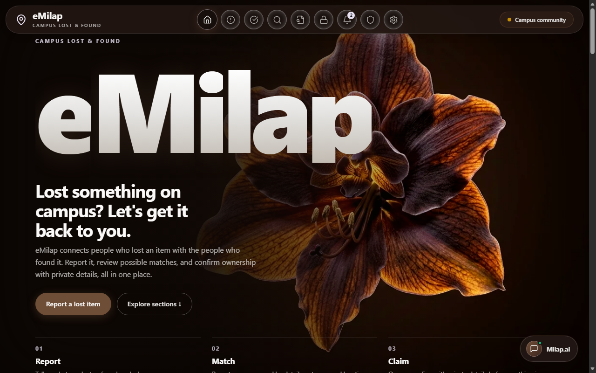
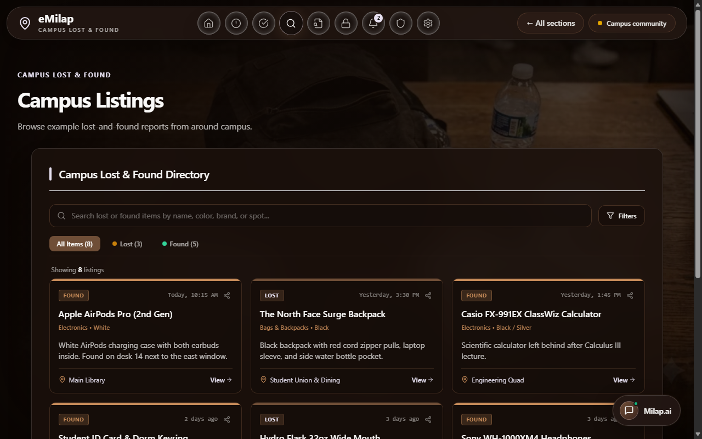
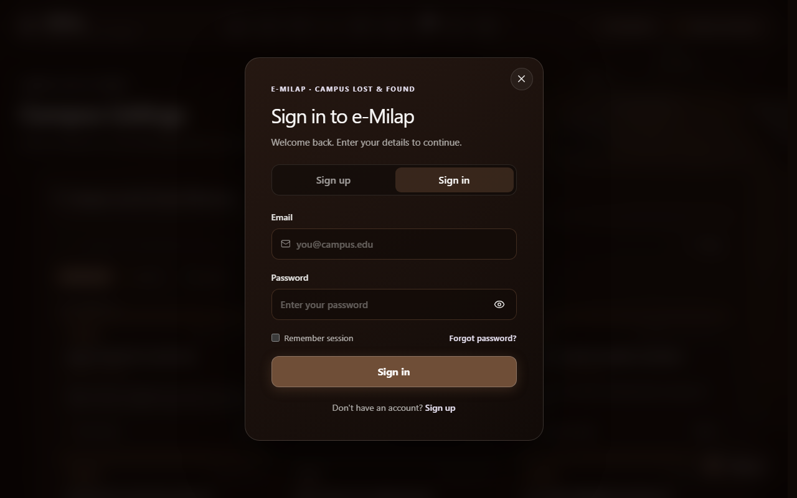
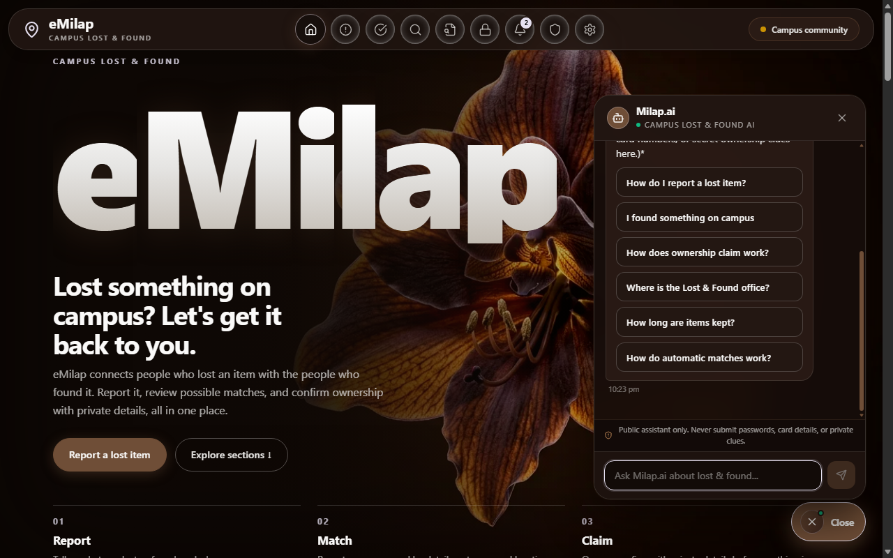
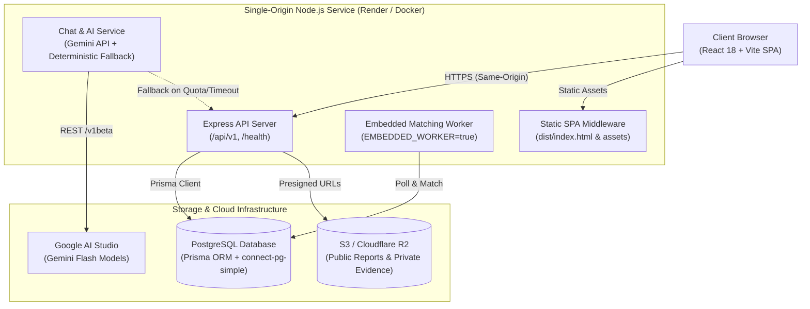

# e-Milap — Campus Lost & Found Platform

> A privacy-first, automated lost-and-found recovery platform tailored for university and college campuses.

[](https://emilap.onrender.com)
[](https://nodejs.org)
[](https://www.typescriptlang.org/)
[](https://vitejs.dev/)

e-Milap bridges the gap between campus members who lose items and those who find them. It combines structured reporting, encrypted private ownership verification, automated background matching, and an AI-powered campus assistant with local deterministic fallback.

---

## Table of Contents

- [Live Demo](#live-demo)
- [Visual Overview](#visual-overview)
- [Key Features](#key-features)
  - [For Campus Users](#for-campus-users)
  - [For Developers & Administrators](#for-developers--administrators)
- [System Architecture](#system-architecture)
- [Technology Stack](#technology-stack)
- [Repository Structure](#repository-structure)
- [Local Development Setup](#local-development-setup)
  - [Prerequisites](#prerequisites)
  - [1. Clone & Install](#1-clone--install)
  - [2. Environment Configuration](#2-environment-configuration)
  - [3. Database Setup & Migrations](#3-database-setup--migrations)
  - [4. Running the Development Services](#4-running-the-development-services)
- [Testing & Quality Assurance](#testing--quality-assurance)
- [Environment Variables](#environment-variables)
- [Chatbot & AI Configuration](#chatbot--ai-configuration)
  - [Dynamic Model Prioritization](#dynamic-model-prioritization)
  - [Deterministic Fallback](#deterministic-fallback)
  - [Safe Server-Side Observability](#safe-server-side-observability)
- [Production Deployment (Render)](#production-deployment-render)
  - [Blueprint Overview](#blueprint-overview)
  - [Storage Considerations](#storage-considerations)
- [Security & Privacy Boundary](#security--privacy-boundary)
- [Troubleshooting](#troubleshooting)
- [Contributing](#contributing)
- [License](#license)

---

## Live Demo

A live deployment of e-Milap is accessible at:

**[https://emilap.onrender.com](https://emilap.onrender.com)**

> **Note on Render Free Tier:** The live demo is hosted on a Render Free web service. If the service has been inactive, Render will spin it down. The initial request may take 30–60 seconds while the container performs a cold start. Health check endpoint: `/health/live`.

---

## Visual Overview

The screenshots below are real, unedited captures from the deployed e-Milap application.

| Overview & Hero | Campus Listings Directory |
| :---: | :---: |
| <br><sub>**Home & Overview:** Interactive campus lost & found hero featuring navigation, quick action buttons, and live community stats.</sub> | <br><sub>**Campus Directory:** Filterable real-time directory with category tabs, search queries, and status tags (Lost vs. Found).</sub> |

| Authentication Interface | Milap.ai Campus Assistant |
| :---: | :---: |
| <br><sub>**Campus Sign-In:** Email and password authentication with cookie sessions and campus community affiliation.</sub> | <br><sub>**Milap.ai Assistant:** Context-aware chatbot providing desk locations, reporting guidance, and route navigation.</sub> |

---

## Key Features

### For Campus Users

- **Structured Reporting:** Log lost or found items with category tags, approximate campus location, timestamps, and public descriptions.
- **Privacy-Preserving Claims:** Claimants submit private verification details (e.g., serial numbers, lock-screen descriptions, unique markings) that are encrypted and withheld from the public feed.
- **Real-Time Directory Search:** Instantly browse and filter active campus listings by keyword, category, or status (Open, Matched, Claim Pending, Resolved).
- **Automated Match Discovery:** Background matching engine compares lost and found listings and alerts owners when a high-probability match is identified.
- **Campus Desk Guidance:** Built-in operating hours, drop-off locations (Administration Building, Room 104), and office contact protocols.

### For Developers & Administrators

- **Single-Origin Express & Vite Architecture:** In production, the Express API serves both the REST endpoints and the compiled Vite SPA from a unified HTTPS origin, eliminating cross-site cookie blocking.
- **Embedded Matching Worker:** The background matching loop can run in-process (`EMBEDDED_WORKER=true`), enabling full worker functionality on single-container hosting environments.
- **Multi-Tenant Community Scoping:** Every report, membership, and search is strictly scoped to a `Community` entity.
- **Encrypted Field Storage:** Sensitive claimant verification details use AES-256-GCM encryption at rest with initialization vectors.
- **Zero-Secret Observability:** Server-side chat observability logs status categories (`success`, `quota`, `invalid_key`, `timeout`, `unavailable_model`) without logging user tokens, cookies, or prompt plaintexts.

---

## System Architecture



---

## Technology Stack

| Layer | Technologies |
| :--- | :--- |
| **Frontend** | React 18, Vite 6, Tailwind CSS 3, Lucide React, Three.js, React Three Fiber, GSAP, Lenis Smooth Scroll |
| **Backend** | Node.js (>=20), Express 4, TypeScript 5, Zod 3, Helmet, CORS, Cookie-Parser |
| **Authentication** | `express-session`, `connect-pg-simple`, `bcryptjs`, HttpOnly Secure Cookies |
| **Database & ORM** | PostgreSQL, Prisma ORM 5.22 |
| **Security & Cryptography** | Node.js `crypto` (AES-256-GCM, PBKDF2), Zod input validation schemas |
| **Storage Adapter** | AWS SDK v3 (`@aws-sdk/client-s3`, `@aws-sdk/s3-request-presigner`), local filesystem adapter |
| **AI Integration** | Google Gemini API (REST `/v1beta/models`), rule-based token/keyword retrieval engine |
| **Testing & Tooling** | Vitest 2.1, ESLint, TypeScript `tsc`, Concurrently, Docker Compose |

---

## Repository Structure

```text
eMilap/
├── apps/
│   ├── api/                     # Express REST API application
│   │   ├── src/
│   │   │   ├── config/          # Environment validation & configuration
│   │   │   ├── db/              # Prisma client singleton
│   │   │   ├── jobs/            # Background matching worker & scheduler
│   │   │   ├── lib/             # AES-256-GCM encryption & security utilities
│   │   │   ├── middleware/      # Auth guards, role checks, session handling
│   │   │   ├── modules/         # Domain modules (auth, chat, claims, reports, etc.)
│   │   │   │   └── chat/        # Milap.ai chatbot service, models & tests
│   │   │   ├── storage/         # S3 & local storage provider implementations
│   │   │   └── server.ts        # Express app entrypoint & single-origin static handler
│   │   └── package.json
│   ├── ai/                      # Optional Python AI service workspace
│   └── web/                     # Frontend client workspace reference
├── database/
│   ├── prisma/
│   │   └── schema.prisma        # Complete database schema definition
│   └── scripts/
│       ├── migrate.mjs          # Database migration runner script
│       └── verify-db.mjs        # Database connectivity & schema verification
├── docs/
│   └── screenshots/             # Verified real application screenshots
├── infra/
│   └── compose.yaml             # Local PostgreSQL Docker Compose configuration
├── packages/
│   └── contracts/               # Shared TypeScript data contracts & schemas
├── public/                      # Static web assets & icons
├── src/                         # React SPA source code
│   ├── components/              # UI components (browse, claims, chat, reports, layout)
│   ├── context/                 # AuthContext & React state providers
│   ├── data/                    # Navigation and default campus records
│   ├── hooks/                   # Custom React hooks (smooth scroll, canvas)
│   └── lib/                     # Client API fetcher & route handlers
├── .env.example                 # Local environment template
├── .env.production.example      # Production environment template
├── package.json                 # Monorepo workspaces & root npm scripts
├── render.yaml                  # Render Infrastructure-as-Code Blueprint
├── tailwind.config.js           # Tailwind CSS theme configuration
└── vite.config.js               # Vite build configuration
```

---

## Local Development Setup

### Prerequisites

- **Node.js**: `v20.0.0` or higher
- **npm**: `v10.0.0` or higher
- **Docker**: (Optional, for running local PostgreSQL)

### 1. Clone & Install

```bash
git clone https://github.com/diyannsh/eMilap.git
cd eMilap
npm install
```

### 2. Environment Configuration

Copy the template to `.env`:

```bash
cp .env.example .env
```

Review `.env` and configure your development database URL and session parameters. Never commit `.env` to Git.

### 3. Database Setup & Migrations

If using Docker for local PostgreSQL:

```bash
# Start local PostgreSQL container
npm run db:up

# Generate Prisma Client
npx prisma generate --schema=database/prisma/schema.prisma

# Run database migrations
npm run db:migrate

# Verify database connectivity and schema integrity
npm run db:verify
```

*(To stop the local database container later: `npm run db:down`)*

### 4. Running the Development Services

You can run individual workspaces or all services concurrently:

```bash
# Run both Vite frontend and API concurrently:
npm run dev:all

# OR run frontend only (http://localhost:5173):
npm run dev

# OR run API only (http://localhost:4000):
npm run dev:api

# OR run background matching worker independently:
npm run dev:worker
```

---

## Testing & Quality Assurance

The API test suite uses Vitest to test authentication, encrypted clues, session management, storage abstractions, chatbot model selection, and fallback paths:

```bash
# Run API test suite (60 unit & integration tests):
npm run test:api

# Run TypeScript typecheck on the API:
npm run typecheck:api

# Run workspace-wide typecheck:
npm run typecheck

# Build both frontend and API for production:
npm run build:all

# Start compiled production server locally:
npm start
```

---

## Environment Variables

| Variable | Required in Prod | Description |
| :--- | :---: | :--- |
| `NODE_ENV` | Yes | Application environment (`development` or `production`). |
| `PORT` | Yes | HTTP listening port for Express (e.g. `10000` on Render, `4000` locally). |
| `DATABASE_URL` | Yes | PostgreSQL connection URI (e.g. Supabase, Neon, or local PostgreSQL). |
| `SESSION_SECRET` | Yes | Secret key (minimum 32 characters) used to sign session cookies. |
| `SESSION_COOKIE_NAME` | No | Session cookie identifier (defaults to `foundnear.sid`). |
| `SESSION_TTL_HOURS` | No | Session validity duration in hours (defaults to `168` / 7 days). |
| `CLUE_ENCRYPTION_KEY` | Yes | 64-character hexadecimal key (32 bytes) for AES-256-GCM clue encryption. |
| `EMBEDDED_WORKER` | No | Set to `"true"` to run background matching loop inside the API web service. |
| `WORKER_POLL_INTERVAL_MS`| No | Matching worker polling frequency in milliseconds (e.g. `5000`). |
| `STORAGE_LOCAL` | No | Set to `"false"` in production. Ephemeral disk will lose uploaded files on restart. |
| `S3_ENDPOINT` | Conditional | S3-compatible API endpoint (e.g., Cloudflare R2 or MinIO). Omit for AWS S3. |
| `S3_REGION` | Conditional | Storage region (e.g., `auto` for R2, or `us-east-1` for AWS). |
| `S3_BUCKET_REPORTS` | Conditional | Bucket for publicly visible item listing photographs. |
| `S3_BUCKET_EVIDENCE` | Conditional | Strictly private bucket for claimant proof images (presigned URL access only). |
| `S3_ACCESS_KEY_ID` | Conditional | S3 access key ID for uploading and signing report media. |
| `S3_SECRET_ACCESS_KEY` | Conditional | S3 secret access key. |
| `GEMINI_API_KEY` | No | Optional Google AI Studio API key for Milap.ai live generation. |
| `GEMINI_MODEL` | No | Explicit model override (defaults dynamically to active Flash models). |

> **Security Rule:** Real credentials, database passwords, and encryption keys must only be stored in your host's secret manager or local uncommitted `.env`. Never commit secrets to tracked Git files.

---

## Chatbot & AI Configuration

e-Milap includes an interactive campus lost-and-found assistant, **Milap.ai**, located in the lower-right corner of the interface.

### Dynamic Model Prioritization

When `GEMINI_API_KEY` is configured, the server queries Google AI Studio's models endpoint (`GET /v1beta/models`) to inspect models enabled for that specific API project. It selects models in this preference order:

1. **`gemini-3.8-flash`** (Recommended by Google for new deployments)
2. **`gemini-3.5-flash-lite`** (Ultra-low latency lightweight model)
3. **`gemini-2.5-flash`** (Production fallback)
4. **`gemini-2.5-flash-lite`**

Retired or shut-down models (including `gemini-1.5-flash` and `gemini-2.0-flash`) are hard-blocked by an internal blacklist (`SHUTDOWN_MODELS`) to prevent HTTP 404 errors.

### Deterministic Fallback

If `GEMINI_API_KEY` is omitted, or if Google returns:
- **HTTP 429**: Rate limit or quota exhaustion (free tier depleted)
- **HTTP 401 / 403**: Invalid key or project billing restrictions
- **Timeout**: Upstream response exceeds 3.5 seconds

The system automatically and transparently falls back to the deterministic campus search assistant. It delivers exact campus office locations, route actions, and public keyword search results with zero downtime.

### Safe Server-Side Observability

Every chat interaction emits a sanitized log to stdout:

```text
[e-Milap Chat Observability] provider=gemini status=success model=gemini-2.5-flash communityId=default-community durationMs=36
```

Or upon fallback:

```text
[e-Milap Chat Observability] provider=deterministic-retrieval status=quota model=none communityId=default-community durationMs=35 reason="Live Gemini response unavailable (Gemini API free-tier quota limit reached (HTTP 429).). Fallen back safely to deterministic campus search."
```

**Privacy Guarantee:** Observability logs never output the API key, cookies, session tokens, authorization headers, or private user messages.

---

## Production Deployment (Render)

### Blueprint Overview

The repository includes a ready-to-use Render Blueprint specification in [`render.yaml`](render.yaml):

1. **Runtime:** Node.js Web Service on the Free plan.
2. **Build Command:**
   ```bash
   npm ci --include=dev && npx prisma generate --schema=database/prisma/schema.prisma && npm run build:all
   ```
3. **Start Command:**
   ```bash
   node apps/api/dist/server.js
   ```
4. **Health Check Path:** `/health/live`
5. **In-Process Worker:** `EMBEDDED_WORKER=true` enables the background matcher inside the web service, avoiding the need for a separate paid worker instance.

### Storage Considerations

Render Free web service instances run in ephemeral containers that restart periodically.
- Setting `STORAGE_LOCAL=true` on Render will save uploads to temporary container disk, which will be lost whenever the service sleeps or redeploys.
- For durable photo uploads, configure S3-compatible cloud storage (such as Cloudflare R2 or AWS S3) using the `S3_*` environment variables in the Render dashboard.
- If S3 storage is unconfigured, the application gracefully fails closed on media uploads while all text reporting, searching, claims, and chat features remain operational.

---

## Security & Privacy Boundary

- **Private Clue Encryption:** Confidential verification clues provided by report filers are encrypted using AES-256-GCM. Plaintext clues are never stored in database tables or returned by public listing APIs.
- **Session Security:** Session cookies use `HttpOnly`, `SameSite=Lax`, and `Secure` attributes in production to prevent client-side JavaScript interception.
- **Single-Origin Deployment:** Serving the API and frontend under the same domain avoids third-party cookie restrictions enforced by modern browsers.
- **Moderator Access Control:** Administrative views and moderation endpoints verify active campus staff roles (`MODERATOR` or `ADMIN`) before displaying audit logs or claim evidence.
- **Public API Stripping:** Endpoints returning public reports strip creator user IDs, private clues, and claim histories from the response payload.

---

## Troubleshooting

| Problem | Cause | Resolution |
| :--- | :--- | :--- |
| **Site takes ~50s to load on first visit** | Render Free container sleeping | Expected behavior on free tier. Render spins down services after 15 minutes of inactivity. Subsequent requests are immediate. |
| **Database error on startup** | Invalid or unreachable `DATABASE_URL` | Ensure your PostgreSQL instance allows SSL connections (`?sslmode=require`) and that network firewalls allow external access. |
| **Image uploads return error** | S3 credentials incomplete | Configure durable S3 or Cloudflare R2 bucket credentials. Avoid `STORAGE_LOCAL=true` in cloud deployments. |
| **Chatbot responds with deterministic links instead of AI** | `GEMINI_API_KEY` missing, expired, or quota reached | Inspect the server logs for `[e-Milap Chat Observability]` to check the exact sanitized category (`unconfigured`, `quota`, or `invalid_key`). |
| **Vite / TypeScript build fails** | Development dependencies omitted | Ensure build runs with `npm ci --include=dev` so build-time tools (Vite, TypeScript, esbuild) are installed. |

---

## Contributing

Contributions to e-Milap are welcome. To contribute:

1. Fork the repository on GitHub.
2. Create a descriptive feature branch (`git checkout -b feature/my-feature`).
3. Commit your changes following standard commit conventions.
4. Ensure all tests and typechecks pass (`npm run test:api && npm run typecheck:api && npm run build:all`).
5. Push to your branch and submit a Pull Request.

---

## License

No formal license file is currently present in this repository. All rights reserved by the repository owner. If you intend to use this code commercially or redistribute it, please contact the repository maintainers
