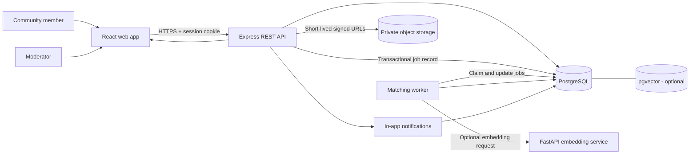

# FoundNear AI

## Research, Product Strategy & Technical Design

**Project category:** AI for campus utility, community safety, and
resource recovery\
**Target users:** Students, hostel residents, faculty, staff, campus
security, and authorized moderators\
**Initial deployment:** One college or hostel community\
**Core principle:** AI helps people discover possible matches; humans
verify ownership.

---

# 1. Executive Summary

FoundNear AI is a community-scoped lost-and-found platform that helps
people report missing items, discover potentially matching found items,
privately prove ownership, and coordinate recovery. Instead of relying
only on scattered WhatsApp groups, noticeboards, or word of mouth, the
platform brings reporting, search, matching, claims, notifications, and
resolution tracking into one workflow.

The system combines **structured information**---such as category,
color, date, and approximate location---with optional text embeddings to
rank likely matches. It does not treat AI similarity as proof. Ownership
remains a human-reviewed decision, while private identifying details and
claim evidence are kept out of public listings and AI inputs.

The MVP is deliberately practical: a responsive web app, a modular
TypeScript API, PostgreSQL with optional `pgvector` support, object
storage for images, and a database-backed worker. Deterministic matching
remains available when the AI service is offline. This makes the project
demonstrable without requiring a costly or complicated distributed
infrastructure.

## One-line value proposition

**FoundNear AI turns scattered campus lost-and-found reports into a
searchable, privacy-first recovery workflow with explainable AI-assisted
matching and human-verified handovers.**

## The user outcome

A student who loses an item can create one structured report and receive
relevant suggestions. A finder can report an item without revealing all
its identifying details. The likely owner can submit private evidence,
and an authorized reviewer can make and record the final decision.

---

# 2. Problem Statement

Lost items in colleges and hostels are often reported through fragmented
channels: informal group chats, verbal announcements, noticeboards, or
separate security desks. These channels can be useful, but information
becomes difficult to search, old posts are easily missed, and reports
may not reach the person who needs them.

The problem is not simply that people cannot post a message. The harder
challenge is **connecting two incomplete reports safely**: one
describing a missing item and another describing an item that has been
found. People may use different words, forget exact dates, provide
incomplete details, or be unsure where an item was lost.

A recovery system therefore needs to solve five linked problems:

1.  **Fragmented reporting:** lost and found information is spread
    across different channels.
2.  **Weak discoverability:** users must manually scan posts or
    repeatedly ask whether an item has been found.
3.  **Incomplete descriptions:** a lost report and a found report may
    describe the same object differently.
4.  **Ownership and privacy:** a public listing should not reveal all
    the details a genuine owner could use to verify a claim.
5.  **No consistent resolution trail:** users and moderators need a
    clear way to track claims, decisions, and completed handovers.

## Problem statement

> How might a college or hostel community make lost-and-found reporting
> searchable, connect incomplete reports efficiently, and help return
> items to their rightful owners without exposing private identifying
> information or relying on AI as proof of ownership?

## Scope boundary

FoundNear AI is designed for **community item recovery**, not general
surveillance, facial recognition, identity scoring, or automated
ownership adjudication. It does not guarantee that every lost item will
be recovered. It improves the process of reporting, discovering,
verifying, and coordinating.

---

# 3. Target Users and Jobs to Be Done

---

User Main need FoundNear AI support

---

Student who lost an Report once and Guided lost-item form,
item discover relevant found search, match
reports suggestions,
notifications

Person who found an Report it without Guided found-item form
item disclosing every and protected details
identifying detail

Claimant Demonstrate that an Private claim form and
item belongs to them restricted evidence
upload

Reporter/finder Avoid handing an item Reviewable ownership
to the wrong person evidence and clear
claim states

Campus Handle disputes and Community-scoped
moderator/security suspicious reports moderation, audit
staff consistently history, status
tracking

Community administrator Keep the service useful Membership controls,
and trustworthy moderation settings,
retention policies

---

## Primary user journeys

### Journey A --- Lost item

1.  Sign in and select the relevant community.
2.  Create a lost report with category, description, color, date,
    approximate location, and optional image.
3.  Receive possible matches as reports are created or updated.
4.  Open a suggestion and compare the visible information.
5.  Submit private ownership evidence if a plausible match is found.
6.  Coordinate a safe handover after the claim is approved.
7.  Confirm recovery so the report can be closed.

### Journey B --- Found item

1.  Sign in and create a found report.
2.  Share only safe public details.
3.  Keep distinguishing details private for verification.
4.  Review a claim or route it to an authorized moderator.
5.  Approve, reject, or request additional information.
6.  Confirm handover and mark the report resolved.

### Journey C --- Moderator review

1.  Open a flagged report, claim, or dispute within the moderator's
    community.
2.  Review only the information needed for that decision.
3.  Record a decision and a reason category.
4.  Keep an audit record of the actor, action, target, and time.
5.  Escalate unresolved cases according to community policy.

---

# 4. Product Goals and Success Criteria

## Product goals

- Make reports easy to create and find.
- Improve discovery of plausible lost/found pairs.
- Protect details that could be used to make a fraudulent claim.
- Keep the system useful when AI is unavailable.
- Give users and moderators a transparent recovery workflow.
- Make the MVP affordable and feasible for a student team to build and
  operate.

## Proposed MVP metrics

These are **targets to validate**, not claims of achieved performance.

---

Metric Definition Initial target

---

Report completion Percentage of started ≥ 85%
report forms  
 successfully  
 submitted

Match usefulness Percentage of Establish baseline, then
reviewed top-5 improve
suggestions judged  
 plausible

Precision@5 Relevant pairs among Measure on reviewed examples
the top five  
 suggested pairs

False-match rate Suggested pairs Establish baseline and
judged clearly reduce
incompatible

Recovery confirmation Approved cases with Track by cohort
confirmed handover

Time to first useful Time from report Measure median and 90th
suggestion creation to first percentile
plausible candidate

Reliability Successful report 100% of tested deterministic
creation when the AI fallback cases
service is  
 unavailable

Notification Duplicate 0 in idempotency tests
duplication notifications caused  
 by job retries

Privacy leakage Private fields 0 in automated tests
appearing in public  
 API responses,  
 search, embeddings,  
 or notifications

---

Do not present targets as measured results until the product has been
tested. Record the dataset size, evaluation method, and limitations
whenever reporting model performance.

---

# 5. Proposed Solution

FoundNear AI uses a structured workflow with six connected capabilities.

## 5.1 Structured reporting

Reports use consistent fields instead of depending only on free-text
posts:

- Report type: `LOST` or `FOUND`
- Item category
- Public description
- Color and optional public attributes
- Approximate date and location
- Optional image
- Separate private identifying details
- Lifecycle status

Guided fields improve search and provide useful signals for matching.
Users should be able to leave uncertain fields blank rather than
inventing details.

## 5.2 Community-scoped search

Members browse reports only within communities they are authorized to
access. Search supports category, keywords, date range, and status.
Community membership is enforced by the server, not merely hidden in the
user interface.

## 5.3 Hybrid candidate matching

The matching pipeline first applies eligibility rules and deterministic
scoring. If configured, text embeddings retrieve additional candidates
that use different wording. A ranking stage combines available signals
and shows suggestions with appropriate uncertainty.

## 5.4 Private ownership claims

A claimant submits evidence in a restricted workflow. Public reports do
not expose every distinguishing detail. Claim evidence is not included
in embeddings or ordinary match responses. The reporter or an authorized
moderator makes the final decision.

## 5.5 Notifications and status tracking

Users receive in-app notifications for relevant candidate matches and
claim updates. Notifications are deduplicated so background-job retries
do not repeatedly alert the same user for the same event.

## 5.6 Moderation and accountability

Moderators can review flagged reports, claims, and disputes within their
assigned community. Sensitive access and moderation decisions are
recorded in an audit trail.

---

# 6. What Makes FoundNear AI Different?

A winning project should not claim that no lost-and-found tools or
matching systems exist. The defensible contribution is the **specific
combination and implementation** of features for a college/hostel
setting.

---

Common approach or FoundNear AI response Why it matters
limitation

---

Reports scattered One searchable, Less manual searching
across chats and structured community and fewer missed
noticeboards workflow reports

Exact keyword search Deterministic matching Can discover plausible
misses differently plus optional candidates despite
worded descriptions text-embedding wording differences
retrieval

Public descriptions may Public/private field Makes fraudulent claims
reveal every separation and harder and protects
identifying detail restricted claim privacy
evidence

Similarity score may be Human-reviewed claims Keeps ownership
mistaken for proof and explicit audit decisions accountable
decisions

AI service may be Deterministic baseline Core reporting and
unavailable or too works independently matching remain usable
expensive

Background jobs can Idempotent jobs and More reliable user
retry and create notification experience
duplicate alerts deduplication

Feedback can be noisy Separate weak rejection Reduces the risk of
feedback from confirmed training or evaluating
recovery and against misleading
moderator-reviewed labels
outcomes

A generic multi-tenant Single-community launch Feasible MVP with a
platform can be costly with community IDs and path to expansion
to operate membership  
 relationships in the  
 data model

---

## Core differentiators

1.  **Privacy-first matching:** private identifying details are reserved
    for verification, not discovery.
2.  **Hybrid AI with a deterministic fallback:** embeddings enhance
    candidate discovery without becoming a single point of failure.
3.  **Human-in-the-loop ownership verification:** AI ranks
    possibilities; people decide claims.
4.  **Traceable decisions:** report versions, scoring versions, claim
    decisions, and audit events can be inspected.
5.  **MVP-first architecture:** one deployable modular application and a
    database-backed worker avoid premature infrastructure complexity.

These are design differentiators. Their practical advantage must be
demonstrated through usability tests, match evaluations, privacy tests,
and recovery outcomes.

---

# 7. Research Findings and Technical Rationale

This section summarizes relevant technical guidance from primary
documentation. It supports implementation choices; it is not a
substitute for field research with actual students, finders, or campus
staff.

## 7.1 PostgreSQL and vector search

PostgreSQL can keep reports, memberships, claims, notifications, job
state, and audit records in one relational database. The `pgvector`
extension supports vector storage and similarity search. Prisma
documentation explains that custom vector types may require customized
SQL migrations and raw SQL queries, depending on the Prisma version and
integration used.

**Decision:** use PostgreSQL as the system of record. Introduce
`pgvector` only when text embeddings are enabled. Keep vector operations
behind a repository/service boundary so the rest of the application does
not depend on a specific vector-query implementation.

**Important trade-off:** approximate nearest-neighbor indexes can
improve search speed but may trade away recall. Community and category
filters can also affect how many candidates survive vector retrieval.
Start with a simple baseline and measure before adding indexes or tuning
retrieval settings.

## 7.2 Secure sessions

OWASP's Session Management guidance recommends strong, unpredictable
session identifiers, server-side session lifecycle controls, and careful
handling of session credentials.

**Decision:** use server-managed sessions in secure cookies. In
production, use `HttpOnly`, `Secure`, and an appropriate `SameSite`
policy; protect state-changing routes against CSRF; expire and revoke
sessions server-side; and avoid placing session tokens in URLs or
browser local storage.

## 7.3 Safe image uploads

OWASP's File Upload guidance recommends allowlisting necessary file
types, validating actual content rather than trusting a client-provided
MIME type, generating storage names, limiting file sizes, and
restricting upload access.

**Decision:** accept only the image formats required by the MVP,
validate file signatures where practical, generate object keys
server-side, enforce file-size limits, and use short-lived signed URLs.
Keep object storage private by default. Add malware scanning or image
moderation where feasible.

## 7.4 AI should be an assistive signal

Embedding similarity measures semantic or visual proximity; it does not
establish that two reports refer to the same physical object or that a
claimant owns it.

**Decision:** use AI only to retrieve or rank candidates. Apply hard
eligibility constraints before presenting results, show users that
suggestions are uncertain, and retain human review for ownership claims.

## 7.5 Why not start with a large microservice platform?

The initial deployment serves one community and has a modest, unproven
workload. Separately deployable web/API/AI/worker components provide
enough separation without introducing a message broker, orchestration
cluster, or complex service mesh at the outset.

**Decision:** start with a modular API, a separate matching worker,
PostgreSQL-backed jobs, object storage, and a separately deployable AI
service. Add infrastructure only when observed scale, reliability, or
team needs justify it.

### Research references

- Prisma documentation --- PostgreSQL extensions:
  https://www.prisma.io/docs/orm/v6/prisma-schema/postgresql-extensions
- pgvector project documentation: https://github.com/pgvector/pgvector
- OWASP Session Management Cheat Sheet:
  https://cheatsheetseries.owasp.org/cheatsheets/Session_Management_Cheat_Sheet.html
- OWASP File Upload Cheat Sheet:
  https://cheatsheetseries.owasp.org/cheatsheets/File_Upload_Cheat_Sheet.html

---

# 8. System Requirements

## 8.1 Functional requirements

---

ID Requirement Priority

---

FR-01 Users can register, log Must
in, log out, and manage
sessions

FR-02 Users can join or Must
request access to a  
 community

FR-03 Server authorization Must
enforces community  
 membership and roles

FR-04 Members can create, Must
edit, view, and close  
 lost/found reports

FR-05 Reports support Must
category, public  
 description, date,  
 approximate location,  
 and optional images

FR-06 Private identifying Must
details are stored  
 separately from public  
 fields

FR-07 Members can search and Must
filter eligible reports
in their community

FR-08 New or materially Must
updated reports enqueue
matching work

FR-09 Deterministic matching Must
works without the AI  
 service

FR-10 Optional text Should
embeddings improve  
 candidate retrieval

FR-11 Users can receive Must
deduplicated in-app  
 match notifications

FR-12 Claimants can submit Must
private ownership  
 evidence

FR-13 Authorized reviewers Must
can approve, reject, or
request more  
 information

FR-14 Claim decisions and Must
moderation actions are  
 audited

FR-15 Users can reject a Should
suggestion and suppress
the pair

FR-16 Moderators can review Should
flagged reports and  
 disputes

FR-17 Optional email and Future
image embeddings can be
added later

---

## 8.2 Non-functional requirements

- **Security:** authorization is checked on the server for every
  protected resource.
- **Privacy:** private details and claim evidence are excluded from
  public APIs, notifications, and embeddings.
- **Reliability:** report creation does not depend on AI availability.
- **Consistency:** report updates and job creation use a transaction
  or transactional-outbox pattern.
- **Idempotency:** retries do not create duplicate logical candidates,
  claims, or notifications.
- **Observability:** structured logs include correlation IDs but avoid
  passwords, session tokens, private evidence, and sensitive item
  details.
- **Accessibility:** forms have labels, keyboard navigation, visible
  focus, and clear error messages.
- **Maintainability:** shared request/response schemas and service
  boundaries reduce duplication.
- **Portability:** local development can run with Docker Compose and
  documented environment variables.
- **Scalability:** the worker can be scaled independently if
  measurements justify it.

---

# 9. Recommended Technology Stack

---

Layer Proposed technology Reason

---

Web frontend React, TypeScript, Vite Fast iteration and
reusable UI

Styling and UI Tailwind CSS and Consistent responsive
accessible component interface
primitives

Routing/data React Router and Route management and
TanStack Query server-state handling

Forms/validation React Hook Form and Zod Validated forms with
shared schemas

REST API Node.js, TypeScript, Familiar modular
Express backend

ORM Prisma Relational schema and
migration workflow

Database PostgreSQL Relational integrity
and transactions

Vector search `pgvector`, optional Text embedding
retrieval

AI service Python and FastAPI Isolated model/provider
integration

Background jobs PostgreSQL-backed job Simple retries and
table/queue pattern operational footprint

Image storage Private S3-compatible Images stay outside
object storage relational rows

Local environment Docker Compose Reproducible
development

Testing Unit, integration, API Confidence in critical
authorization, and workflows
end-to-end tests

Deployment Managed PostgreSQL, Simple initial
container host, static operations
frontend hosting

---

**Version policy:** select mutually compatible stable versions at
implementation time and lock dependencies. Do not copy package versions
from an old tutorial without checking current compatibility.

---

# 10. Architecture Overview



## Component boundaries

---

Component Owns

---

Web app Forms, search, report cards, match
explanations, claim screens,
moderator interface

API Validation, authentication,
authorization, business workflows,
stable response contracts

PostgreSQL Canonical records, constraints, job
state, notifications, audit trail

Matching worker Candidate retrieval, scoring, retry
behavior, idempotent persistence

AI service Embedding generation only; no claim
adjudication or access to ownership
evidence

Object storage Private report images and private
claim evidence, separated by access
policy

Moderation workflow Human review, dispute handling,
decision records

---

The API is the authority for access control and lifecycle state. The AI
service returns signals only.

---

# 11. Matching Algorithm

## 11.1 Two-stage pipeline

### Stage A --- Eligibility and candidate retrieval

Only compare eligible opposite-type reports from the same community.
Exclude:

- Same report or self-pairs
- Same-type pairs
- Cross-community pairs
- Resolved, removed, expired, or rejected pairs
- Reports that the current user is not authorized to access

Then retrieve candidates using category, time, approximate location,
structured attributes, and optionally text-vector similarity.

### Stage B --- Transparent ranking

A provisional weighted score can be used as a starting point:

---

Signal Initial weight Notes

---

Public description 35% Keyword similarity
similarity initially; embeddings
optional

Category 20% Strong compatibility
compatibility signal, but avoid
excluding all
imperfect category
choices

Shared public 15% Color, brand, item
attributes type, or other safe
structured fields

Time compatibility 15% Proximity between
lost and found dates

Approximate location 15% Distance or shared
compatibility campus area, without
exposing precise
private locations

---

**These weights are hypotheses, not validated facts.** Calibrate them
against reviewed examples. If a signal is missing, do not automatically
treat it as a contradiction; score available signals with a documented
confidence adjustment. Strong conflicts may reduce or exclude a
candidate, depending on the field.

A UI can present a match band such as "Possible match" rather than
suggesting certainty. Do not show private details or sensitive score
explanations that could help a fraudulent claimant.

## 11.2 Baseline before AI

The first version should use:

1.  Opposite report type and same-community eligibility.
2.  Category compatibility.
3.  Normalized text tokens and common-word handling.
4.  Structured public attributes.
5.  Date and approximate location proximity.
6.  Minimum thresholds and candidate deduplication.

This baseline provides a comparison point for evaluating whether
embeddings genuinely improve retrieval.

## 11.3 Optional text embeddings

When enabled:

1.  Build an embedding only from approved public fields.
2.  Record provider/model name, model version, dimensions, and source
    report version.
3.  Retrieve nearest eligible candidates through `pgvector`.
4.  Merge vector candidates with deterministic candidates.
5.  Apply eligibility rules and ranking.
6.  Persist score components and algorithm version.

Never embed private ownership details, claim evidence, contact
information, or restricted moderator notes. If the embedding provider is
unavailable, continue with deterministic matching and retry the optional
AI job later.

## 11.4 Feedback and model evaluation

A rejected suggestion is useful but noisy. It may be wrong, incomplete,
or simply not useful to the user. An accepted suggestion is also not
proof of ownership.

Use stronger labels where available:

- Confirmed item recovery
- Moderator-reviewed match outcome
- Claim decision and final handover status

Track precision among top-ranked suggestions, recall on known recovered
pairs, false-match rate, time to first useful suggestion, and recovery
confirmation rate. Document sample size and limitations. Avoid claiming
improved accuracy until the comparison has been measured.

---

# 12. Privacy, Security, and Trust

## 12.1 Data classification

---

Data type Visibility AI use

---

Public report Authorized community May be used after
description members validation and
sanitization

Public attributes Authorized community May be used
members

Approximate location Authorized community May be used in scoring
and date members, at appropriate  
 granularity

Private distinguishing Reporter and explicitly Never
details authorized reviewer,  
 according to policy

Claim evidence Claimant and explicitly Never
authorized reviewer

Contact details Only as required for an Never
approved workflow

Password/session Server-side protected Never
secrets storage and secure cookie  
 flow

Audit events Authorized Never as matching input
administrators/moderators

---

## 12.2 Security controls

- Hash passwords with a modern password-hashing algorithm and safe
  parameters.
- Use secure, revocable server-side sessions.
- Set `HttpOnly`, `Secure`, and appropriate `SameSite` cookie
  attributes in production.
- Apply CSRF protection to state-changing cookie-authenticated routes.
- Rate-limit login, registration, report creation, claims, and
  uploads.
- Enforce membership and role checks at every protected API operation.
- Use private object storage, generated object keys, size limits,
  actual content validation, and short-lived signed URLs.
- Keep public report images and private claim evidence under distinct
  access policies.
- Audit sensitive evidence access and all claim/moderation decisions.
- Redact credentials, private details, and evidence from logs and
  error traces.
- Define retention, deletion, and account-anonymization policies.
- Keep secrets in environment or platform secret storage, use TLS,
  back up the database, and test restoration.
- Use generic password-reset responses to avoid revealing whether an
  email is registered.

## 12.3 Threats and mitigations

---

Threat Mitigation

---

Fraudulent ownership claim Private distinguishing details,
restricted evidence, human review,
audit history

Cross-community data access Server-side membership checks and
authorization tests

Private data exposed in a response Separate data models/DTOs,
serialization allowlists, automated
leakage tests

Malicious image upload Allowlist formats, validate
content, limit size, generate
names, private storage

Session theft or misuse Secure cookies, session
rotation/revocation, idle and
absolute expiry, no tokens in URLs

Spam and duplicate reports Rate limits, duplicate checks,
abuse flags, moderation

Job retry creates duplicate Idempotency keys and unique
notifications constraints

AI outage Deterministic fallback and bounded
retry policy

Misleading similarity score Human review, uncertainty labels,
evaluation against confirmed
outcomes

Excessive moderator access Least privilege, community-scoped
roles, sensitive-access audit

---

---

# 13. Data Model --- Conceptual Overview

The detailed schema and migrations belong in the implementation phase.
The initial model should include:

- `User`
- `Community`
- `CommunityMembership`
- `ItemReport`
- `ItemImage`
- `ItemAttribute`
- `PrivateReportDetail`
- `ItemEmbedding`
- `MatchCandidate`
- `OwnershipClaim`
- `ClaimEvidence`
- `Notification`
- `BackgroundJob`
- `ReportStatusHistory`
- `AuditLog`

## Important integrity rules

- Each report belongs to one community and one creator.
- Community membership is checked before report, claim, match, or
  evidence access.
- Report type and lifecycle status use controlled enums.
- Match pairs have a canonical ordering and a uniqueness constraint to
  prevent duplicate pairs.
- Candidate records store the versions of both reports and the
  algorithm version used for scoring.
- A claim has a clear state machine and records reviewer, decision
  time, and reason category.
- Evidence objects are not returned by public report endpoints.
- Notification deduplication keys are unique.
- Job state includes attempts, availability time, lock/lease
  information, and last error category.
- Audit events are append-oriented and access-controlled.

## Suggested report lifecycle

`DRAFT → ACTIVE → CLAIM_PENDING → RESOLVED`

Alternative transitions should be explicit, including `EXPIRED`,
`REMOVED`, or `REOPENED` if the policy permits. Avoid allowing arbitrary
status changes from the client; validate every transition in the service
layer.

## Suggested claim lifecycle

`SUBMITTED → UNDER_REVIEW → APPROVED | REJECTED | MORE_INFO_REQUESTED`

A claim decision must not automatically mark the item as recovered. The
handover and recovery confirmation are separate steps.

---

# 14. Key Workflows

## 14.1 Report creation

1.  Authenticate the user and confirm community membership.
2.  Validate the request with a shared schema.
3.  Upload an optional image through a short-lived signed URL.
4.  Save the report, safe public fields, protected private fields,
    status history, and matching job.
5.  Return a stable response with report ID and processing state.
6.  Run matching asynchronously.

The report update and job record should be committed atomically, or use
a transactional outbox pattern, so a saved report cannot silently miss
its matching job.

## 14.2 Match processing

1.  Claim a pending job using a safe database locking/lease pattern.
2.  Load the current report version and eligible opposite-type reports.
3.  Compute deterministic candidates.
4.  Request embeddings only when configured and available.
5.  Merge candidates and apply ranking rules.
6.  Upsert candidate records with score components and source versions.
7.  Create deduplicated notifications for qualifying candidates.
8.  Mark the job complete, or retry with backoff and a maximum attempt
    policy.

## 14.3 Claim review and handover

1.  Claimant submits evidence through a private route.
2.  API verifies membership, report eligibility, and claim limits.
3.  Evidence is uploaded to private storage with a short-lived signed
    URL.
4.  Authorized reviewer inspects the evidence.
5.  Reviewer approves, rejects, or requests more information.
6.  System records the decision and audit event.
7.  Users coordinate handover using the community's approved process.
8.  Recovery is confirmed and the report is resolved.

---

# 15. API Surface --- Initial Proposal

The final route names may change during implementation. Every route must
validate inputs and enforce authorization server-side.

---

Method Route Purpose

---

`POST` `/api/v1/auth/register` Register an account

`POST` `/api/v1/auth/login` Create a session

`POST` `/api/v1/auth/logout` Revoke current session

`GET` `/api/v1/me` Get current user and
memberships

`GET` `/api/v1/communities` List communities
available to the user

`POST` `/api/v1/communities/:id/join-requests` Request community
membership

`GET` `/api/v1/reports` Search
community-visible
reports

`POST` `/api/v1/reports` Create a lost/found
report

`GET` `/api/v1/reports/:id` View an authorized
report

`PATCH` `/api/v1/reports/:id` Edit an authorized
report

`POST` `/api/v1/reports/:id/close` Close or withdraw a
report

`POST` `/api/v1/uploads/presign` Request a scoped upload
URL

`GET` `/api/v1/reports/:id/matches` View eligible match
suggestions

`POST` `/api/v1/matches/:id/feedback` Reject or provide
feedback on a
suggestion

`POST` `/api/v1/reports/:id/claims` Submit a claim

`POST` `/api/v1/claims/:id/evidence` Attach private evidence

`POST` `/api/v1/claims/:id/decision` Authorized reviewer
decision

`GET` `/api/v1/notifications` List notifications

`POST` `/api/v1/notifications/:id/read` Mark notification as
read

`GET` `/api/v1/moderation/queue` List authorized
moderation tasks

`POST` `/api/v1/moderation/reports/:id/action` Apply an audited
moderation action

---

## API design rules

- Use consistent error objects and status codes.
- Never trust a client-supplied user ID, community role, score, or
  report ownership field.
- Do not return private details from general report endpoints.
- Use pagination and bounded page sizes.
- Validate status transitions in service logic.
- Apply authorization to nested resources, not only the top-level
  report.
- Use idempotency keys where clients may retry sensitive create
  operations.
- Keep API versions stable and document the request/response schemas.

---

# 16. Repository Structure

```text
foundnear-ai/
├── apps/
│   ├── web/
│   │   └── src/
│   │       ├── app/
│   │       ├── pages/
│   │       ├── features/
│   │       ├── components/
│   │       ├── lib/
│   │       └── types/
│   ├── api/
│   │   └── src/
│   │       ├── routes/
│   │       ├── controllers/
│   │       ├── services/
│   │       ├── repositories/
│   │       ├── middleware/
│   │       ├── schemas/
│   │       ├── jobs/
│   │       ├── db/
│   │       └── app.ts
│   └── ai/
│       └── app/
│           ├── routers/
│           ├── services/
│           ├── models/
│           └── main.py
├── packages/
│   └── contracts/
├── database/
│   ├── prisma/
│   │   ├── schema.prisma
│   │   └── migrations/
│   └── seeds/
├── infra/
│   ├── docker/
│   └── compose.yaml
├── tests/
│   ├── unit/
│   ├── integration/
│   ├── authorization/
│   └── e2e/
├── .env.example
├── package.json
└── README.md
```

---

# 17. Testing and Validation Plan

## 17.1 Functional testing

- Registration, login, logout, and session expiry
- Community join and membership revocation
- Lost/found report creation, editing, and closure
- Search, filtering, and pagination
- Match creation and refresh after report edits
- Claim submission, evidence upload, review, and handover
- Notification unread state and deduplication
- Moderator actions and audit history

## 17.2 Security and privacy testing

- A user from Community A cannot access Community B reports or claims.
- A non-member cannot access a private image or claim evidence URL.
- A normal member cannot invoke moderator-only actions.
- Private details never appear in public report responses, search
  indexes, embeddings, logs, or notifications.
- Expired or revoked sessions are rejected.
- Invalid file types, oversized files, and unauthorized uploads are
  rejected.
- Client-supplied roles, owner IDs, and match scores are ignored or
  rejected.
- Repeated requests do not create duplicate claims, candidates, or
  notifications.

## 17.3 Matching evaluation

Create a small, consented evaluation set of reviewed lost/found pairs.
Include positive pairs, hard negatives, incomplete descriptions,
spelling variations, and missing attributes. Avoid using real personal
or sensitive information in a demo dataset.

Compare:

1.  Keyword/structured baseline
2.  Baseline plus text embeddings
3.  Alternative scoring weights, if sample size permits

Report Precision@5, false-match rate, recall on known pairs, and time to
first plausible suggestion. Use a clear label definition and record the
number of evaluated examples. Do not tune and evaluate on exactly the
same examples without disclosing that limitation.

## 17.4 Usability validation

Test the report form with representative students and staff. Observe
whether users understand public versus private details, can report an
item without guessing, can interpret match suggestions, and know what
happens after a claim is submitted. Use the results to simplify
confusing fields and instructions.

---

# 18. Implementation Roadmap

---

Phase Deliverable Exit criteria

---

1\. Product validation Interview notes, user Main user needs and MVP
journeys, privacy rules scope agreed

2\. Repository Monorepo, linting, Web, API, and database
foundation environment config, run locally
health checks

3\. Database Relational schema, Migrations run from a
migrations, clean database
constraints, seed data

4\. Authentication Registration, sessions, Authorization tests
communities, roles pass

5\. Reports and search Lost/found CRUD, End-to-end report
filters, public/private journey works
separation

6\. Image storage Signed uploads, Unauthorized image
validation, private access is blocked
access

7\. Deterministic Job table, worker, Matches work with AI
matching scoring, candidate disabled
storage

8\. Notifications In-app notifications Retries do not create
and deduplication duplicates

9\. Text embeddings AI service, versioned Evaluated improvement
embeddings, vector or documented
retrieval no-benefit result

10\. Claims and review Private evidence, Claim-to-handover
decisions, audit trail workflow works

11\. Moderation Flag queue and Moderation actions are
community-scoped tools authorized and audited

12\. Quality and Automated tests and Results and limitations
evaluation match benchmark documented

13\. Deployment Production config, Restore and basic
backups, monitoring, incident checks
README completed

---

## MVP priority order

**Build first:** authentication, community authorization, report
creation, search, deterministic matching, claims, notifications, and
audit events.

**Add after core workflows work:** text embeddings, richer moderation,
email notifications, image similarity, speech input, advanced
dashboards, and multi-community administration.

Do not build image embeddings, voice reporting, or complex
infrastructure merely to make the project sound more advanced.
Demonstrate that the core workflow works first.

---

# 19. Risks and Mitigations

---

Risk Impact Mitigation

---

False matches Users waste time or Thresholds, clear
lose trust uncertainty, feedback,
Precision@5 evaluation

Fraudulent claims Item may be handed to Private evidence, human
the wrong person review, audit trail

Poor report quality Relevant pairs are Guided forms, examples,
missed optional fields,
editing

AI outage Delayed semantic Deterministic fallback
matching and retry

Private data leakage User trust and safety Separate models/DTOs,
harmed least privilege,
automated leakage tests

Duplicate jobs Repeated work and Unique keys,
alerts transaction-safe
enqueueing, idempotent
writes

Unsafe image upload Abuse or storage risk Validation, limits,
private storage,
moderation

Low evaluation sample Performance claims Report sample size and
size become unreliable uncertainty; avoid
unsupported claims

Scope expansion MVP is never completed Milestone gates and
deferred feature list

Model change Scores become Persist model and
inconsistent algorithm versions

Misleading feedback Poor evaluation or Treat feedback as weak
future model behavior evidence; prioritize
confirmed outcomes

Moderation Users dispute decisions Defined reason
inconsistency categories, audit
records, community
policy

---

---

# 20. Deployment and Operations

## Local development

Use Docker Compose for PostgreSQL (with `pgvector` enabled if required),
private S3-compatible object storage, API, worker, and AI service. The
React frontend can run through Vite. Provide `.env.example` with
variable names and safe placeholder values, never real secrets.

## Initial production setup

- Static frontend hosting or CDN
- Small container host for API and worker
- AI service deployed separately if embeddings are enabled
- Managed PostgreSQL with backups
- Private object storage
- TLS and domain configuration
- Centralized error monitoring and structured logs
- Documented backup restoration and deployment rollback procedures

## Operational principles

- Set health and readiness endpoints.
- Use bounded retries with backoff; do not retry permanent validation
  failures indefinitely.
- Keep failed jobs inspectable and reprocessable.
- Monitor queue age, job failure rate, API errors, storage errors,
  database capacity, and notification duplication.
- Keep secrets out of logs and source control.
- Test restore procedures, not only backup creation.
- Make AI-provider configuration optional so the app can start without
  it.

---

# 21. Budget and Feasibility Strategy

The architecture is designed to keep the initial operating footprint
small, but actual costs depend on provider, region, storage volume,
traffic, and embedding model.

Cost-control measures:

1.  Start with one community and a limited report retention policy.
2.  Use deterministic matching as the default baseline.
3.  Generate embeddings only when needed and cache them by report
    version/model version.
4.  Avoid re-embedding unchanged reports.
5.  Store images in object storage rather than database blobs.
6.  Use a managed database plan sized for the pilot and monitor growth.
7.  Keep the AI provider configurable; compare local and hosted options
    using latency, quality, and operating cost.
8.  Avoid paid services until the prototype demonstrates a clear
    benefit.

Do not publish a precise monthly cost estimate until provider choices,
expected usage, retention, and deployment region are known.

---

# 22. Demonstration Plan for a Hackathon or Project Review

A convincing demo should show a complete recovery story rather than only
a dashboard.

## Demo scenario

1.  A student reports a lost blue notebook near the library.
2.  Another user reports finding a notebook in a nearby campus area,
    using different wording.
3.  The worker processes the reports and displays a possible match with
    a clear uncertainty label.
4.  The claimant submits a private distinguishing detail that is not
    visible in the public report.
5.  The authorized reviewer approves the claim.
6.  The users coordinate the handover and confirm recovery.
7.  The moderator view shows the status history and audit trail.
8.  Disable the AI service and create another report to demonstrate that
    deterministic matching still functions.
9.  Attempt to open another community's report or private evidence as an
    unauthorized user; show that access is denied.

## What judges should see

- A real end-to-end workflow
- Explainable match factors without exposing private details
- Human-controlled ownership verification
- A working AI-off fallback
- Community-level authorization
- Private evidence access restrictions
- Measured evaluation rather than unsupported accuracy claims

---

# 23. Suggested Pitch

## 30-second version

"FoundNear AI helps college and hostel communities recover lost items
through one privacy-first platform. Users submit structured lost or
found reports, and a hybrid matching engine combines clear rules with
optional AI text similarity to surface possible matches. Unlike a system
that treats similarity as proof, FoundNear keeps ownership evidence
private and leaves the final decision to a human reviewer. The MVP is
designed to work even when the AI service is offline."

## Why is this needed if lost-and-found groups already exist?

"Existing groups help people publish information, but posts can be
fragmented, difficult to search, and easy to miss. FoundNear focuses on
the full recovery workflow: structured reports, ranked suggestions,
private ownership claims, review, and resolution tracking. We are not
claiming that lost-and-found systems do not exist; our contribution is
making this workflow more searchable, privacy-conscious, measurable, and
suitable for a campus community."

## What is the role of AI?

"AI is used to improve candidate discovery when descriptions use
different wording. It does not decide ownership. Structured matching
remains available as a baseline, and every ownership claim goes through
a human-controlled verification process."

## What happens if AI is unavailable?

"The core system continues using deterministic matching based on
category, public attributes, time, and approximate location. AI jobs can
be retried later without losing the original report."

## How do you prevent fake claims?

"We do not expose every identifying detail publicly. The claimant
submits evidence through a private workflow, and an authorized reviewer
checks it. Decisions are recorded in an audit trail. A similarity score
alone can never approve a claim."

## How will you prove it works?

"We will compare a deterministic baseline with the optional
embedding-enhanced version using reviewed lost/found pairs. We will
measure Precision@5, false-match rate, and time to first plausible
suggestion, and report the dataset size and limitations. We will also
test authorization, private-data separation, job retries, and confirmed
recovery workflows."

---

# 24. Decisions to Keep Consistent

- Community membership is the access boundary for reports, matches,
  claims, and moderation.
- Public descriptions, private identifying details, and claim evidence
  remain separate.
- Deterministic matching is always available; AI is optional.
- AI produces similarity signals only. People make ownership
  decisions.
- Matching jobs and notifications are idempotent and traceable to
  report/model versions.
- PostgreSQL is the source of truth; `pgvector` is an optional
  extension for vector retrieval.
- Images and evidence live in private object storage, not public
  database fields.
- Start with a modular application and database-backed worker.
- Evaluate before claiming accuracy, impact, or cost savings.
- Add infrastructure only when measured needs justify it.

---

# 25. Conclusion

FoundNear AI is strongest when presented not as "AI that magically finds
everything," but as a practical recovery workflow that combines
structured reporting, hybrid candidate discovery, privacy-preserving
ownership verification, and accountable human decisions.

Its technical strategy is intentionally incremental: build the core
community workflow, establish a deterministic baseline, measure its
performance, and then add embeddings only where they provide
demonstrated value. The architecture supports future growth without
forcing a student project to operate unnecessary infrastructure from day
one.

**The success criterion is not the complexity of the model. It is
whether the system helps people recover items more reliably while
protecting their privacy and maintaining trust.**

---

# Appendix A --- Implementation Checklist

## Product

- [ ] Validate the problem with students, hostel staff, and campus
      security.
- [ ] Agree report lifecycle and claim decision policy.
- [ ] Define what is public versus private.
- [ ] Set report and evidence retention rules.

## Engineering

- [ ] Create monorepo and lock compatible dependency versions.
- [ ] Add database migrations and seed data.
- [ ] Add authentication and community authorization tests.
- [ ] Implement reports and search.
- [ ] Implement private image upload.
- [ ] Implement deterministic matching and worker retries.
- [ ] Add notification deduplication.
- [ ] Add private claims, reviewer decisions, and audit events.
- [ ] Add optional embedding retrieval behind a feature flag.
- [ ] Add monitoring, backups, and restoration instructions.

## Evaluation

- [ ] Prepare reviewed positive and negative report pairs.
- [ ] Define label criteria before measuring.
- [ ] Compare deterministic and embedding-enhanced results.
- [ ] Measure Precision@5 and false-match rate.
- [ ] Record sample size and known limitations.
- [ ] Test the AI-off workflow.
- [ ] Test that private data never appears in public responses or
      embeddings.

## Demo

- [ ] Prepare a lost/found scenario with different wording.
- [ ] Show a possible match, not an ownership verdict.
- [ ] Demonstrate private evidence and human review.
- [ ] Demonstrate recovery confirmation.
- [ ] Demonstrate access denial for an unauthorized user.
- [ ] Demonstrate deterministic fallback.

---

# Appendix B --- Glossary

---

Term Meaning

---

Deterministic matching Rules and scores computed from
structured fields and text without
requiring an AI model

Embedding A numeric representation of text
used to retrieve semantically
similar descriptions

Candidate retrieval Finding a manageable set of reports
that might match

Ranking Ordering candidates by
compatibility signals

Precision@5 The proportion of the top five
results that are relevant, under a
defined evaluation label

Recall The proportion of known relevant
pairs that the system successfully
retrieves

Idempotency Repeating an operation does not
create duplicate logical effects

Signed URL A time-limited URL granting a
narrowly scoped storage action

Audit trail A record of who performed an
action, what happened, and when

Transactional outbox A pattern that records an event/job
in the same database transaction as
the data change, then processes it
asynchronously

---

---

# Appendix C --- Research and Reference Links

1.  **Prisma ORM --- PostgreSQL extensions:**
    https://www.prisma.io/docs/orm/v6/prisma-schema/postgresql-extensions
2.  **pgvector --- vector similarity search and indexing:**
    https://github.com/pgvector/pgvector
3.  **OWASP --- Session Management Cheat Sheet:**
    https://cheatsheetseries.owasp.org/cheatsheets/Session_Management_Cheat_Sheet.html
4.  **OWASP --- File Upload Cheat Sheet:**
    https://cheatsheetseries.owasp.org/cheatsheets/File_Upload_Cheat_Sheet.html

These references support selected implementation decisions. The product
assumptions, initial weights, performance targets, and expected impact
in this document remain hypotheses until validated with users and test
data.
